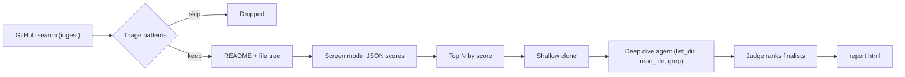

# Librarians of Babel v2

Finds remarkable new GitHub repos before they have stars. A rebuild of the v1 pipeline (`poc/discover.py` in jackieoliver/librarian-of-babel-1) that keeps its best ideas and fixes what the 2026-02-14 10k run showed.

## What v1 taught us

- Kept: cheap deterministic triage before any model call (hard-skip name/description patterns from v1 `workers/assess/novelty.py`), harsh "most repos are mediocre" rubric, practical value over novelty, provenance check (score the novel part, not the inherited framework).
- Fixed: v1 screened on metadata alone (name, description, stars), so its "gems" were mostly famous repos (GrapheneOS/hardened_malloc, 1.7k stars) and 190 screens failed as `error`. v2 has a star ceiling, shows the screener the README and file tree, and validates JSON with retries.
- New: an agentic deep dive. A mid-tier model gets a read-only shallow clone and `list_dir` / `read_file` / `grep` tools, and must cite files for its claims (is the code real, or a README over an empty shell?). Finalists are then ranked by one judge call that sees all verdicts side by side.

## Pipeline



Each stage is cheaper than the next and passes on fewer repos, so only the top screened repos are ever cloned. Every stage writes a JSON file in the run folder, and `--resume` skips the ones already done.

1. **Ingest**: GitHub search, repos created in the last N days with a few stars, not forks.
2. **Triage** (free): hard-skip patterns, no description, tiny size.
3. **Screen** (cheap model, ~$0.0002/repo): README + file tree summary, JSON scores.
4. **Deep dive** (agent, ~$0.01/repo): top screened repos, tool-using model reads the clone. Repo code is never executed.
5. **Judge**: one call ranks the deep-dived finalists.
6. **Report**: `report.html` in the run folder.

## Run

```bash
uv run babel.py --days 7 --max-candidates 1500 --deep 25 --budget 2.00
```

Needs `~/.config/secrets/openrouter_api_key` and a logged-in `gh`. Runs write to `/mnt/data/work/librarian-of-babel/runs/<timestamp>/` (clones go there too and are deleted after the deep dive). `--budget` is a hard stop on model spend in USD.

## Run log

- **2026-10-21, run1** (7 days, 2–60 stars): 2,100 candidates → 600 past triage → 596 screened → 30 deep dives (28 ok, 2 ran out of turns) → 6 gems, 19 worth a look. $0.54 total (screen ~$0.0003/repo, deep dive ~$0.017/repo). Gems: willwaltz/globes, zer0ducksgiven/Forza-Motorsport-2-ReGPU, mr-finster/vf3-recomp, Ambitosis/OpenWinter, alkove-ai/alkove, GreenSwampDweller/torchlight-rekindled. Bias seen: sorting by stars fills the top 30 with game recompilation and reverse-engineering projects; the judge also emitted two placeholder rows (dropped by the report).
